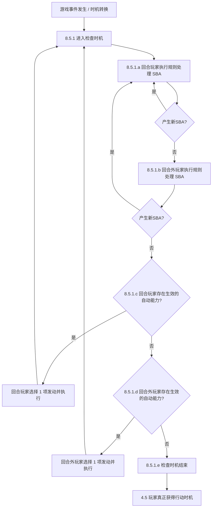
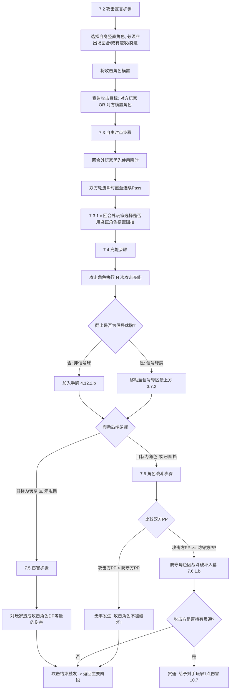

# 《战双帕弥什 卡牌对战》规则编译与引擎架构设计规格书（初版设计稿）

> **历史文档**：本文是项目初期依据《综合规则》A0 初版 (2025-11-14) 编写的设计稿，保留作架构参考。
> 其中的规则描述已过时（缺少 V1.1~V1.4 新增内容，且部分条款理解有误），**规则一律以 [`docs/rules/rule-specification.md`](../rules/rule-specification.md) 为准**。
> 类型定义、协议、接口等以代码 (`packages/shared`) 为准。

> 依据文档：《战双帕弥什 卡牌对战》综合规则 (A0 初版发行，2025-11-14)
> 平台定位：网页端在线多人实时对战平台（Authoritative Server）

---

## 目录
1. 游戏完整生命周期与流程
2. 游戏阶段与回合状态机 (Phase State Machine)
3. 游戏区域模型 (Zone Model & Slot Structure)
4. 玩家状态模型 (Player Model)
5. 卡牌数据与版本模型 (Card & CardVersion Model)
6. 牌组构筑合法性验证规则 (Deck Validation Rules)
7. Action 系统定义 (Client -> Server Actions)
8. Event 驱动系统 (Server -> Client Events)
9. Trigger 与检查时机系统 (Trigger & Priority Loop)
10. Effect 效果引擎与层级系统 (Continuous / One-shot / Replacement Effects)
11. Target 目标选择与合法性系统 (Targeting System)
12. 战斗与攻击流程模型 (Combat Resolution System)
13. 伤害处理与侵蚀计数机制 (Damage & Erosion System)
14. 核心特殊机制深度建模 (升变 / 信号球消除 / 装备 / 辅助机)
15. 规则处理与胜负判定系统 (State-Based Actions & Win Conditions)
16. GameState 核心 TypeScript 强类型定义
17. 数据库 ER 设计与 Prisma Schema 初版
18. WebSocket 双向通信协议 (Socket.IO Typed Events)
19. RESTful API 接口定义与 OpenAPI 规范
20. 前端用户界面架构与 HUD 布局设计
21. 管理员后台系统架构 (Card Management & Batch Import)
22. 规则书歧义与未尽事项汇总 (RULE_UNCERTAIN)
23. 引擎规则自动化测试方案与用例矩阵

---

## 1. 游戏完整生命周期与流程

根据综合规则第 5 章与第 6 章，一局标准的战双帕弥什对战遵循严格的线性生命周期：

```mermaid
flowchart TD
    Setup[5.2 游戏准备] --> DetermineFirst[5.2.1.c 决定先攻后攻]
    DetermineFirst --> InitErosion[5.2.1.d 侵蚀计数置0]
    InitErosion --> DrawInitial[5.2.1.e 抽4张起始手牌]
    DrawInitial --> Mulligan[5.2.1.e 调度: 选N张放牌组底, 抽N张]
    Mulligan --> ShuffleDeck[5.2.1.f 牌组洗切]
    ShuffleDeck --> InitCost[5.2.1.f 牌组顶2张牌以正面竖直置入费用区(初始明费)]
    InitCost --> RoundLoop[回合循环: 先攻玩家开始]
    
    subgraph 回合推进循环 [第6章 回合流程]
        StandPhase[6.2 竖直阶段: 战场及费用区所有卡牌竖直]
        DrawChargePhase[6.3 抽牌填充阶段: 先手首回合抽1, 其余抽2; 选0~1张手牌充为明费]
        MainPhase[6.4 主要阶段: 出牌 / 起动 / 装备 / 消3球抽1 / 攻击]
        EndPhase[6.5 结束阶段: 轮流瞬时 -> 回合结束触发 -> 手牌弃至7张 -> 暗费清理 -> 期限效果消除]
        
        StandPhase --> DrawChargePhase
        DrawChargePhase --> MainPhase
        MainPhase --> EndPhase
    end
    
    RoundLoop --> StandPhase
    EndPhase --> SwitchPlayer{胜负已决?}
    SwitchPlayer -- 否: 切换攻守玩家 --> StandPhase
    SwitchPlayer -- 是 --> GameOver[游戏结算 / 胜负公布]
```

---

## 2. 游戏阶段与回合状态机 (Phase State Machine)

引擎采用层级有限状态机 (Hierarchical Finite State Machine, HFSM)。所有阶段的切换必须由引擎根据 Action 和检查时机自动推进，禁止客户端跳步。

```mermaid
stateDiagram-v2
    [*] --> PRE_GAME
    
    state PRE_GAME {
        DECK_CHECK --> ROLL_FIRST_PLAYER
        ROLL_FIRST_PLAYER --> DRAW_INITIAL_HAND
        DRAW_INITIAL_HAND --> MULLIGAN_ACTIVE
        MULLIGAN_ACTIVE --> MULLIGAN_NON_ACTIVE
        MULLIGAN_NON_ACTIVE --> INIT_COST_ZONE
    }
    
    PRE_GAME --> TURN_LOOP
    
    state TURN_LOOP {
        STAND_PHASE: 6.2 竖直阶段
        DRAW_CHARGE_PHASE: 6.3 抽牌填充阶段
        MAIN_PHASE: 6.4 主要阶段
        END_PHASE: 6.5 结束阶段
        
        state STAND_PHASE {
            StandTrigger --> StandCheck --> StandExecuteReadyAll --> StandExitCheck
        }
        
        state DRAW_CHARGE_PHASE {
            DrawChargeTrigger --> DrawCards --> ChargeCostChoice --> DrawChargeExitCheck
        }
        
        state MAIN_PHASE {
            MainActionTiming --> ResolvePlayCard
            MainActionTiming --> ResolveActivateAbility
            MainActionTiming --> ResolveEquip
            MainActionTiming --> ResolveEliminate3Orbs
            MainActionTiming --> COMBAT_FLOW
            MainActionTiming --> PassToNextPhase
        }
        
        state COMBAT_FLOW {
            7_2_ATTACK_DECLARATION: 攻击宣言步骤
            7_3_FREE_TIMING: 自由时点步骤(瞬时响应 & 阻挡宣言)
            7_4_CHARGE_STEP: 充能步骤(攻击充能)
            7_5_DAMAGE_STEP: 伤害步骤(攻击玩家且未被阻挡)
            7_6_CHARACTER_BATTLE_STEP: 角色战斗步骤(攻击角色或被阻挡)
            
            7_2_ATTACK_DECLARATION --> 7_3_FREE_TIMING
            7_3_FREE_TIMING --> 7_4_CHARGE_STEP
            7_4_CHARGE_STEP --> 7_5_DAMAGE_STEP: 目标为玩家且无阻挡
            7_4_CHARGE_STEP --> 7_6_CHARACTER_BATTLE_STEP: 目标为角色或发生阻挡
            7_5_DAMAGE_STEP --> CombatEndCheck
            7_6_CHARACTER_BATTLE_STEP --> CombatEndCheck
            CombatEndCheck --> MainActionTiming: 返回主要阶段
        }
        
        state END_PHASE {
            InstantWindow --> EndTriggerCheck --> HandDiscardCheck --> ClearHiddenCostsAndBuffs --> TurnTransition
        }
        
        STAND_PHASE --> DRAW_CHARGE_PHASE
        DRAW_CHARGE_PHASE --> MAIN_PHASE
        MAIN_PHASE --> END_PHASE
    }
    
    END_PHASE --> TURN_LOOP: 切换至对手回合
    TURN_LOOP --> GAME_OVER: 触发胜负判定(9.3)
```

---

## 3. 游戏区域模型 (Zone Model & Slot Structure)

根据综合规则第 3 章，对战共有 9 类明确区域。除特殊说明外，每位玩家各自持有一套独立区域：

| 区域代码 (ZoneId) | 中文名称 | 公开性 (Visibility) | 是否有物理顺序 (Ordered) | 数量上限 (Capacity) | 放置状态 (Card Orientation) | 区域归属说明 (3.1) |
| :--- | :--- | :--- | :--- | :--- | :--- | :--- |
| `BATTLEFIELD` | 战场 | 公开 (Public) | 5 个固定卡位 (Slots) | 5 张角色/辅助机卡位 | 竖直/横置 (正面) | 角色与辅助机存在于此；下方可重叠升变卡及装备 |
| `DECK` | 牌组 | 非公开 (Private) | 是 (严格从顶到底) | 初始刚好50张 | 背面 | 抽牌/翻开充能均从顶依次进行 (3.3.3) |
| `HAND` | 手牌 | 操控方私密 (Owner Only) | 玩家可自由排列 | 正常无硬顶，结束阶段上限7张 (3.4.3.a) | 正面(己方)/背面(对手) | 仅操控玩家可查看内容 |
| `GRAVEYARD` | 墓地 | 公开 (Public) | 堆叠放置，自由调整 | 无上限 | 正面 | 堆叠放置在原有卡牌上方 (3.5.2) |
| `COST` | 费用区 | 公开 (Public) | 玩家可自由排列 | 默认上限 10 张 (3.6.4.a) | 明费:正面竖直/横置; 暗费:背面竖直 | 区分明费与暗费；总和超限送墓 (9.5.5) |
| `SIGNAL_ORB` | 信号球区 | 公开 (Public) | 严格有序，禁止变动 | 无上限 (堆叠放置) | 正面 | 攻击充能翻出信号球堆叠置于最上方 (3.7.2) |
| `PROCESSING` | 处理区 | 公开 (Public) | 严格入栈/出栈顺序 | 无上限 (临时周转) | 正面 | 使用中的战术牌、充能翻开卡牌临时存放区 (3.8.1) |
| `EROSION` | 侵蚀计数区 | 公开 (Public) | 纯数值计数 | 0 ~ 7 (达到7败北) | 状态数值 | 记录玩家受到的侵蚀度 (3.9) |
| `REMOVED` | 游戏外/放逐区 | 公开 (Public) | 集合 | 无上限 | 正面 | 规则 5.2.1.a 涉及游戏外卡牌加入牌组 |

### 战场卡位模型 (Battlefield Slot Model)
战场严格由 5 个 Slot 构成（`slotIndex: 0..4`）：
- 一个 Slot 可放置：
  - `role`: 1 张角色牌
  - `underneathCards`: 0~N 张因升变重叠在角色下方的卡牌 (8.11.3.f.1)
  - `equipment`: 0~1 张装备在该角色身上的装备牌 (4.18.3, 4.18.5)
  - 或者单独放置 1 张未装备的装备牌 (8.6.2.e.2)
  - 或者单独放置 1 张辅助机牌 (2.2.2.c.2, 玩家战场最多同时存在1张辅助机)

---

## 4. 玩家状态模型 (Player Model)

```typescript
export interface PlayerState {
  readonly playerId: string;
  readonly seatOrder: 0 | 1; // 0: 先手, 1: 后手
  readonly isFirstPlayer: boolean;
  erosionCount: number; // 侵蚀计数 (0..7)
  hasMulliganed: boolean;
  surrendered: boolean;
  
  // 费用统计快照
  totalCostCount: number; // 明费 + 暗费 (<= 10)
  openCostCount: number; // 明费总数
  availableOpenCostCount: number; // 竖直状态的明费
  exhaustedOpenCostCount: number; // 横置状态的明费
  hiddenCostCount: number; // 暗费总数(背面竖直)
  
  // 词条限制计数器 (Per Turn / Per Game)
  turnAbilityUsage: Record<string, number>; // cardInstanceId -> 发动次数 (10.1)
  gameAbilityUsage: Record<string, number>; // cardNumber -> 发动次数 (10.11)
}
```

---

## 5. 卡牌数据与版本模型 (Card & CardVersion Model)

依据第 2 章卡牌情报，卡牌模型拆分为元数据与版本规则数据：

```typescript
export enum CardType {
  ROLE = 'ROLE', // 角色牌 (2.2.2.a)
  TACTICS = 'TACTICS', // 战术牌 (2.2.2.b)
  EQUIPMENT = 'EQUIPMENT', // 道具牌-装备 (2.2.2.c.1)
  ASSIST = 'ASSIST', // 道具牌-辅助机 (2.2.2.c.2)
}

export enum ElementAttribute {
  FIRE = 'FIRE', // 火属性 (10.13)
  LIGHTNING = 'LIGHTNING', // 雷属性
  DARK = 'DARK', // 暗属性
  ICE = 'ICE', // 冰属性
  PHYSICAL = 'PHYSICAL', // 物理属性
  NONE = 'NONE', // 无属性 (信号球牌)
}

export enum SignalOrbType {
  RED = 'RED', // 信号球·红 (2.10)
  BLUE = 'BLUE', // 信号球·蓝
  YELLOW = 'YELLOW', // 信号球·黄
}

export interface CardVersionData {
  id: string;
  cardNumber: string; // 2.7 例如: "BP01-001"
  name: string; // 2.1
  cardType: CardType; // 2.2
  cost: number; // 2.3 费用
  attribute: ElementAttribute; // 2.4 属性
  traits: string[]; // 2.6 卡牌特征，如 ["升格者", "灰鸦小队"]
  basePP?: number; // 2.8 基本力量 (角色/装备牌)
  baseDP?: number; // 2.9 基本伤害 (角色牌)
  signalOrb?: SignalOrbType; // 2.10 信号球标记
  isInstant: boolean; // 10.8 是否持有【瞬时】
  ascensionConfig?: AscensionRuleConfig; // 8.11 升变机制配置
  abilities: AbilityDefinition[]; // 8.1 能力列表
  rulesText: string;
  flavorText?: string;
}

export interface AscensionRuleConfig {
  targetFilter: CardFilterCondition; // 8.11.2.a.1 升变对象 (例如: "费用<=5 的 <露西亚>")
  restrictionFilter?: GameStateCondition; // 8.11.2.a.2 限制条件 (例如: "费用上限>=5")
  ascensionCost: number; // 8.11.2.b 升变代价 (例如: 3费)
  grantKeywords: string[]; // 8.11.2.c 升变出场获得词条，如 ["RUSH"]
}
```

---

## 6. 牌组构筑合法性验证规则 (Deck Validation Rules)

根据综合规则 5.1 节，牌组必须经过强类型校验机检验：
1. **总张数限制 (5.1.2.a)**：牌组必须**恰好 50 张**卡牌 (`cards.length === 50`)。
2. **同名卡上限 (5.1.2.b)**：同一卡牌编号 (`cardNumber`) 的卡牌在牌组中**不得超过 4 张**。
3. **信号球硬性构成 (5.1.2.c)**：牌组中必须投入：
   - 恰好 4 张 `<信号球·红>`
   - 恰好 4 张 `<信号球·蓝>`
   - 恰好 4 张 `<信号球·黄>`
   - （合计 12 张信号球牌，且各自依然必须满足同一卡号不超过 4 张的限制）。
4. **永久能力置换 (5.1.2.d)**：某些卡牌拥有的构筑永久能力作为置换效果应用于上述构筑规则（引擎保留 Hook）。

---

## 7. Action 系统定义 (Client -> Server Actions)

客户端向服务端提交的一切请求，全部封装为具有原子 ID 和签名的 Action：

```typescript
export type GameAction =
  | { type: 'SURRENDER'; playerId: string } // 1.2.4
  | { type: 'CHOOSE_FIRST_PLAYER'; playerId: string; chosenPlayerId: string } // 5.2.1.c
  | { type: 'RESOLVE_MULLIGAN'; playerId: string; cardInstanceIdsToBottom: string[] } // 5.2.1.e
  | { type: 'CHARGE_COST_FROM_HAND'; playerId: string; cardInstanceId?: string } // 6.3.1.c (可选放0或1张)
  | { type: 'PLAY_CARD'; playerId: string; cardInstanceId: string; targetSlotIndex?: number; equipTargetCardId?: string; isAscension?: boolean } // 6.4.1.b.1 / 8.6
  | { type: 'EQUIP_ITEM'; playerId: string; equipmentCardId: string; targetRoleCardId: string } // 6.4.1.b.4
  | { type: 'ELIMINATE_3_ORBS'; playerId: string; orbCardInstanceIds: [string, string, string] } // 6.4.1.b.5
  | { type: 'ACTIVATE_ABILITY'; playerId: string; sourceCardId: string; abilityIndex: number } // 6.4.1.b.3
  | { type: 'DECLARE_ATTACK'; playerId: string; attackerCardId: string; targetType: 'PLAYER' | 'CHARACTER'; targetCardId?: string } // 7.2
  | { type: 'DECLARE_BLOCK'; playerId: string; blockerCardId?: string } // 7.3.1.c (不阻挡则 blockerCardId 为空)
  | { type: 'USE_INSTANT'; playerId: string; cardInstanceId?: string; abilitySourceCardId?: string; pass?: boolean } // 7.3.1.b / 6.5.1.a
  | { type: 'DISCARD_HAND_OVERFLOW'; playerId: string; cardInstanceIds: string[] } // 6.5.1.c
  | { type: 'SELECT_CHOICE_OPTION'; playerId: string; pendingChoiceId: string; selectedIds: string[] } // 8.6.3
  | { type: 'PASS_ACTION_TIMING'; playerId: string }; // 4.5.3.b
```

---

## 8. Event 驱动系统 (Server -> Client Events)

服务端对 Action 进行验证并结算后，原子性更新 GameState，并生成按顺序排布的 `GameEvent[]`。客户端仅监听事件驱动动画：

```typescript
export type GameEvent =
  | { type: 'GAME_STARTED'; firstPlayerId: string; seed: number }
  | { type: 'TURN_STARTED'; turnNumber: number; activePlayerId: string }
  | { type: 'PHASE_CHANGED'; fromPhase: GamePhase; toPhase: GamePhase }
  | { type: 'CARDS_DRAWN'; playerId: string; count: number; cardInstances?: PublicCardInstance[] }
  | { type: 'MULLIGAN_COMPLETED'; playerId: string; bottomCount: number; redrawCount: number }
  | { type: 'CARD_MOVED'; cardInstanceId: string; fromZone: ZoneId; toZone: ZoneId; fromSlot?: number; toSlot?: number; isFaceUp: boolean; isReady: boolean }
  | { type: 'CARDS_SHUFFLED'; playerId: string; zone: ZoneId }
  | { type: 'COST_PAID'; playerId: string; openCostTappedIds: string[]; hiddenCostDiscardedIds: string[] }
  | { type: 'CARD_PLAYED'; playerId: string; cardInstanceId: string; slotIndex: number; isAscension: boolean }
  | { type: 'CARD_ASCENDED'; parentCardId: string; underneathCardIds: string[] }
  | { type: 'CARD_EQUIPPED'; equipmentCardId: string; roleCardId: string }
  | { type: 'ORBS_ELIMINATED'; playerId: string; orbCardIds: string[]; cardDrawnCount: number }
  | { type: 'ATTACK_DECLARED'; attackerCardId: string; targetType: 'PLAYER' | 'CHARACTER'; targetCardId?: string }
  | { type: 'BLOCK_DECLARED'; blockerCardId?: string; isBlocked: boolean }
  | { type: 'ATTACK_CHARGE_PERFORMED'; attackerCardId: string; chargeIndex: number; revealedCard: PublicCardInstance; resultDestination: 'SIGNAL_ORB' | 'HAND' }
  | { type: 'DAMAGE_CHARGE_PERFORMED'; defenderPlayerId: string; revealedCard: PublicCardInstance; placedToCostFaceDown: boolean }
  | { type: 'EROSION_INCREASED'; playerId: string; previousValue: number; newValue: number; reason: 'DAMAGE' | 'DECK_REFRESH' | 'EFFECT' }
  | { type: 'BATTLE_COMPARED'; attackerCardId: string; attackerPP: number; defenderCardId: string; defenderPP: number; destroyedDefenderCardId?: string }
  | { type: 'CARD_DESTROYED'; cardInstanceId: string; reason: 'BATTLE' | 'PP_ZERO' | 'EFFECT' }
  | { type: 'DECK_REFRESHED'; playerId: string; cardsShuffledCount: number; newErosionCount: number }
  | { type: 'CHOICE_REQUIRED'; pendingChoice: PendingChoice }
  | { type: 'GAME_OVER'; winnerPlayerId?: string; isDraw: boolean; reason: string };
```

---

## 9. Trigger 与检查时机系统 (Priority Loop)

根据综合规则 8.5 节，本游戏引擎**不采用传统的 LIFO 堆叠，而是采用符合规则 8.5 的检查时机优先循环 (Check Timing Priority Loop)**：



---

## 10. Effect 效果引擎与层级系统 (Continuous / One-shot / Replacement Effects)

依据综合规则 8.2 与 8.9，效果计算严格分为三类：
1. **单发效果 (8.2.1.a)**：在结算时立刻执行指示动作即销毁（例如抽卡、造成伤害、消灭目标）。
2. **置换效果 (8.2.1.c / 8.10)**：侦测目标事件发生时，取消原事件并直接用新事件替代（8.10.1.a 原事件视为完全未发生）。受影响方自行选择适用顺序，每事件最多适用一次（8.10.2.c）。
3. **持续效果层级系统 (8.9.1 Layers)**：
   - **Layer 1 (8.9.1.a - Base Values)**: 卡牌票面记载的原始基本值（Base PP, Base DP, Cost, Attribute, Traits）。
   - **Layer 2 (8.9.1.b - Non-numeric Modifications)**: 赋予/移除特征、获得/失去能力、改变属性、规则限制。
   - **Layer 3 (8.9.1.c - Numeric Modifications)**: 改变 PP 数值、DP 数值或充能数的持续效果（如 +1000 PP, +1 DP）。
   - **Dependency & Timestamps (8.9.1.d/e)**: 依赖优先，无依赖则按进入区域的时间戳（永久能力）或发动时间戳生效。

---

## 11. Target 目标选择与合法性系统 (Targeting System)

根据 8.6.3：
- 选择指示必须在指定数量内选择尽可能多的合法对象（8.6.3.a）。
- 若记述为“选择最多 X 张”，可选数量为 `0..X`（8.6.3.a.1）。
- 若从非公开区域选择且涉及特征（如“从牌组选择1张角色牌”），由于无法验证，即使存在，玩家仍可**合法放弃选择 (Fail to find)**（8.6.3.a.4）。
- 目标合法性验证必须进行双重核验：
  1. 宣告时验证 (Declaration Validation)
  2. 结算时再次核验 (Resolution Re-check - 8.3.4 若目标已失效或移动区域，则该部分效果不予执行)。

---

## 12. 战斗与攻击流程模型 (Combat Resolution System)

根据第 7 章，攻击由以下 4 到 5 个子流程严格构成：



---

## 13. 伤害处理与侵蚀计数机制 (Damage & Erosion System)

根据 4.10 与 4.12.3：
1. **伤害不是扣除生命值，而是转化成伤害充能与侵蚀度**！
2. 受到 $D$ 点伤害的玩家，执行 $D$ 次独立的伤害充能循环：
   - 抽取牌组顶 1 张卡牌翻开至处理区 (3.8)。
   - 在触发能力结算后，**将该卡牌以背面竖直状态置入费用区作为暗费 (Hidden Cost)** (4.12.3.a)。
   - 该次充能完毕后，**承受伤害的玩家侵蚀计数 + 1** (4.10.1.b)。
3. **特别注意 (4.10.2)**：卡牌效果直接“使玩家侵蚀计数增加”的行动，**不属于伤害处理**，因此绝对不执行伤害充能，也不会产生暗费！

---

## 14. 核心特殊机制深度建模

### 14.1 升变机制 (8.11 Ascension)
- 升变角色牌从手牌打出时，满足属性匹配。
- 选定升变对象（通常为战场已有角色）与卡位。
- 支付升变代价（替代原费用）。
- 升变出场时，被升变的对象卡牌及其下层卡牌全部保持在升变后角色牌的正下方（Stacking）。
- 装备自动转移至升变后角色身上（8.11.3.f.2）。
- 升变角色不继承被升变角色的临时状态与数值（8.11.4.c）。
- 升变角色离场时，其下方所有重叠的卡牌全部送入墓地（9.6）。

### 14.2 信号球消除与抽牌机制 (6.4.1.b.5 & 4.16.2)
- 在主要阶段行动时机，回合玩家可选择信号球区中**任意 3 张物理相邻且连续**的信号球牌送入墓地。
- 结算：若成功消除，执行抽 1 张牌。
- 消除后，不可打乱剩余信号球顺序。

### 14.3 辅助机数量上限 (2.2.2.c.2 & 9.5.4)
- 每位玩家战场最多存在 1 张辅助机。
- 手牌打出新辅助机时，可选择直接替换已有辅助机（已有辅助机入墓，新辅助机占据该卡位，见 8.6.2.e.3）。

---

## 15. 规则处理与胜负判定系统 (State-Based Actions & Win Conditions)

### 15.1 规则处理分类 (9.1)
- **中断型规则处理 (Interruptive SBA - 立即打断当前操作插入执行)**：
  1. `DECK_REFRESH` (9.2): 牌组抽空瞬间，立即将墓地全部卡牌洗回牌组，玩家侵蚀计数 + 1。若牌组和墓地均为空，则立即判负！
  2. `DANGLING_CARDS` (9.6): 宿主角色离开战场时，其下方重叠卡和装备卡立刻送入墓地。
- **检查型规则处理 (Check-timing SBA - 仅在 8.5 检查时机确认执行)**：
  1. `CHECK_WIN_LOSS` (9.3):
     - 侵蚀计数 $\ge 7$ 者判负 (9.3.1.a)。
     - 牌组和墓地均为空者判负 (9.3.1.b)。
     - 双方同时判负则为平局 (1.2.3)。
  2. `PP_ZERO_DESTROY` (9.4): 战场角色 PP $\le 0$ 时立刻因规则破坏入墓。
  3. `ILLEGAL_CARDS` (9.5):
     - 战场非角色/道具卡送墓 (9.5.2)。
     - 角色装备超限（>1）多出者送墓 (9.5.3)。
     - 战场辅助机超限（>1）多出者送墓 (9.5.4)。
     - 费用区总张数超限（>10）多出者送墓 (9.5.5)。

---

## 16. GameState 核心 TypeScript 强类型定义

```typescript
export type GameStatus = 'WAITING' | 'PREPARING' | 'PLAYING' | 'FINISHED';

export type GamePhase =
  | 'STAND_PHASE' // 6.2
  | 'DRAW_CHARGE_PHASE' // 6.3
  | 'MAIN_PHASE' // 6.4
  | 'COMBAT_ATTACK_DECLARATION' // 7.2
  | 'COMBAT_FREE_TIMING' // 7.3
  | 'COMBAT_CHARGE' // 7.4
  | 'COMBAT_DAMAGE' // 7.5
  | 'COMBAT_BATTLE' // 7.6
  | 'END_PHASE'; // 6.5

export interface CardInstance {
  readonly instanceId: string; // 运行时唯一UUID
  readonly cardId: string; // 静态卡牌表ID
  readonly cardNumber: string;
  readonly ownerPlayerId: string;
  controllerPlayerId: string;
  zone: ZoneId;
  slotIndex?: number; // 战场 0..4
  underneathCardIds: string[]; // 升变垫片
  attachedEquipmentId?: string; // 装备
  isFaceUp: boolean;
  isReady: boolean; // true: 竖直, false: 横置
  turnEnteredZone: number; // 进入当前区域的回合数(用于计算出场攻击限制)
}

export interface BattlefieldSlot {
  slotIndex: number;
  roleCardId?: string;
  standaloneEquipmentId?: string;
  assistCardId?: string;
}

export interface PendingTrigger {
  id: string;
  abilityId: string;
  sourceCardInstanceId: string;
  controllerPlayerId: string;
  triggerContext: Record<string, unknown>;
}

export interface PendingChoice {
  id: string;
  playerId: string;
  choiceType: 'SELECT_CARDS' | 'SELECT_SLOT' | 'SELECT_OPTION' | 'YES_NO';
  prompt: string;
  options: { id: string; label: string; payload?: unknown }[];
  minSelections: number;
  maxSelections: number;
}

export interface GameState {
  readonly gameId: string;
  readonly rngSeed: number;
  readonly createdAt: number;
  status: GameStatus;
  turnNumber: number;
  activePlayerId: string;
  nonActivePlayerId: string;
  phase: GamePhase;
  priorityPlayerId: string; // 当前拥有行动时机/选择权的玩家
  
  players: Record<string, PlayerState>;
  cards: Record<string, CardInstance>;
  battlefields: Record<string, BattlefieldSlot[]>; // playerId -> 5 slots
  
  // 正在进行的战斗快照
  currentCombat?: {
    attackerCardId: string;
    targetType: 'PLAYER' | 'CHARACTER';
    targetCardId?: string;
    blockerCardId?: string;
    freeTimingPassCount: number; // 双方连续Pass计数
  };
  
  // 待处理堆
  pendingTriggers: PendingTrigger[]; // 8.5 待机自动能力池
  currentPendingChoice?: PendingChoice;
  
  // 胜负判定结果
  winnerId?: string;
  isDraw: boolean;
  finishReason?: string;
}
```

---

## 17. 数据库 ER 设计与 Prisma Schema 初版

```prisma
datasource db {
  provider = "postgresql"
  url      = env("DATABASE_URL")
}

generator client {
  provider = "prisma-client-js"
}

enum Role {
  USER
  ADMIN
}

enum RoomStatus {
  WAITING
  READY
  PLAYING
  FINISHED
  CLOSED
}

enum CardTypeEnum {
  ROLE
  TACTICS
  EQUIPMENT
  ASSIST
}

enum ElementAttributeEnum {
  FIRE
  LIGHTNING
  DARK
  ICE
  PHYSICAL
  NONE
}

enum SignalOrbTypeEnum {
  RED
  BLUE
  YELLOW
}

model User {
  id            String       @id @default(uuid())
  username      String       @unique
  passwordHash  String
  nickname      String
  avatarUrl     String?
  role          Role         @default(USER)
  createdAt     DateTime     @default(now())
  updatedAt     DateTime     @updatedAt

  decks         Deck[]
  roomPlayers   RoomPlayer[]
  gamePlayers   GamePlayer[]
}

model Card {
  id            String        @id @default(uuid())
  cardNumber    String        @unique // 如 BP01-001
  name          String
  cardType      CardTypeEnum
  attribute     ElementAttributeEnum
  cost          Int
  basePP        Int?
  baseDP        Int?
  signalOrb     SignalOrbTypeEnum?
  traits        String[]      // 数组存储特征
  isInstant     Boolean       @default(false)
  imageUrl      String?
  rulesText     String
  flavorText    String?
  isActive      Boolean       @default(true)
  currentVersion Int          @default(1)
  createdAt     DateTime      @default(now())
  updatedAt     DateTime      @updatedAt

  versions      CardVersion[]
  deckCards     DeckCard[]
}

model CardVersion {
  id            String        @id @default(uuid())
  cardId        String
  versionNumber Int
  snapshotData  Json          // 存储完整规则与效果AST
  createdAt     DateTime      @default(now())

  card          Card          @relation(fields: [cardId], references: [id], onDelete: Cascade)

  @@unique([cardId, versionNumber])
}

model Deck {
  id            String       @id @default(uuid())
  userId        String
  name          String
  description   String?
  isValid       Boolean      @default(false)
  validationLog String?
  createdAt     DateTime     @default(now())
  updatedAt     DateTime     @updatedAt

  user          User         @relation(fields: [userId], references: [id], onDelete: Cascade)
  cards         DeckCard[]
  gamePlayers   GamePlayer[]
}

model DeckCard {
  id            String       @id @default(uuid())
  deckId        String
  cardId        String
  count         Int          @default(1)

  deck          Deck         @relation(fields: [deckId], references: [id], onDelete: Cascade)
  card          Card         @relation(fields: [cardId], references: [id])

  @@unique([deckId, cardId])
}

model Room {
  id            String       @id @default(uuid())
  roomCode      String       @unique
  title         String
  passwordHash  String?
  creatorId     String
  status        RoomStatus   @default(WAITING)
  createdAt     DateTime     @default(now())
  updatedAt     DateTime     @updatedAt

  players       RoomPlayer[]
  games         Game[]
}

model RoomPlayer {
  id            String       @id @default(uuid())
  roomId        String
  userId        String
  seatIndex     Int          // 0 或 1
  isReady       Boolean      @default(false)
  joinedAt      DateTime     @default(now())

  room          Room         @relation(fields: [roomId], references: [id], onDelete: Cascade)
  user          User         @relation(fields: [userId], references: [id])

  @@unique([roomId, userId])
  @@unique([roomId, seatIndex])
}

model Game {
  id            String       @id @default(uuid())
  roomId        String
  rngSeed       BigInt
  winnerUserId  String?
  isDraw        Boolean      @default(false)
  finishReason  String?
  startedAt     DateTime     @default(now())
  finishedAt    DateTime?

  room          Room         @relation(fields: [roomId], references: [id])
  players       GamePlayer[]
  actions       GameActionRecord[]
  events        GameEventRecord[]
}

model GamePlayer {
  id            String       @id @default(uuid())
  gameId        String
  userId        String
  deckId        String
  seatOrder     Int          // 0: 先手, 1: 后手

  game          Game         @relation(fields: [gameId], references: [id])
  user          User         @relation(fields: [userId], references: [id])
  deck          Deck         @relation(fields: [deckId], references: [id])

  @@unique([gameId, userId])
}

model GameActionRecord {
  id            String       @id @default(uuid())
  gameId        String
  seq           Int
  playerId      String
  actionType    String
  payload       Json
  timestamp     DateTime     @default(now())

  game          Game         @relation(fields: [gameId], references: [id])

  @@unique([gameId, seq])
}

model GameEventRecord {
  id            String       @id @default(uuid())
  gameId        String
  seq           Int
  eventType     String
  payload       Json
  timestamp     DateTime     @default(now())

  game          Game         @relation(fields: [gameId], references: [id])

  @@unique([gameId, seq])
}
```

---

## 18. WebSocket 双向通信协议 (Socket.IO Typed Events)

### Client -> Server Events
- `room:join { roomId: string, password?: string }`
- `room:leave {}`
- `room:ready { isReady: boolean, deckId: string }`
- `room:start {}`
- `game:action { action: GameAction }`
- `game:choice { pendingChoiceId: string, selections: string[] }`
- `game:reconnect { gameId: string, token: string }`

### Server -> Client Events
- `room:state_updated { room: PublicRoomState }`
- `game:sync_state { state: PublicGameState }`
- `game:events { events: GameEvent[] }`
- `game:error { code: string, message: string, details?: unknown }`
- `game:choice_required { choice: PendingChoice }`
- `game:ended { winnerId?: string, isDraw: boolean, reason: string }`

---

## 19. RESTful API 接口设计

- `POST /api/auth/register`, `POST /api/auth/login`, `GET /api/auth/me`
- `GET /api/cards` (支持 `type`, `element`, `cost`, `query`, `page` 筛选)
- `GET /api/cards/:id`
- `GET /api/decks`, `POST /api/decks`, `PUT /api/decks/:id`, `DELETE /api/decks/:id`
- `POST /api/decks/:id/validate`
- `GET /api/rooms`, `POST /api/rooms`, `GET /api/rooms/:id`
- `GET /api/games/:id/replay` (完整包含 seed + action 序列以供前端精确重放)
- `POST /api/admin/cards` (管理创建卡牌)
- `PUT /api/admin/cards/:id` (管理更新卡牌，自动升级版本号)
- `POST /api/admin/cards/import` (CSV/JSON 批量导入与格式预检)
- `GET /api/admin/cards/export` (卡牌库导出)

---

## 20. 前端页面结构与游戏 HUD 设计

```
apps/web/
├── app/
│   ├── page.tsx               # 首页 / 快速匹配 / 登录入口
│   ├── rooms/
│   │   ├── page.tsx           # 房间列表与创建弹窗
│   │   └── [id]/page.tsx      # 对战等待室 (准备/选卡组)
│   ├── game/
│   │   └── [id]/page.tsx      # 核心卡牌桌游对战 HUD
│   ├── cards/
│   │   ├── page.tsx           # 卡牌全图鉴与筛选检索
│   │   └── [id]/page.tsx      # 卡牌版本与大图详情
│   ├── decks/
│   │   ├── page.tsx           # 卡组仓库与构筑入口
│   │   └── [id]/page.tsx      # 交互式卡组构筑器 (含合规校验仪)
│   ├── replay/
│   │   └── [id]/page.tsx      # 历史对局 Replay 播放器
│   └── admin/
│       ├── cards/page.tsx     # 管理员卡牌数据表格
│       └── import/page.tsx    # CSV/JSON 批量导入校验控制台
```

### 游戏桌游 HUD 布局设计
- **视觉风格**：战双帕弥什科技终端风格（深灰色底调 `#0b0e14`、全息冰蓝高光 `#00f0ff`、侵蚀警报赤红 `#ff3366`、金色信号球发光）。
- **空间分区**：
  - **顶部对方区**：对手侵蚀度仪表盘（0/7格条状晶格）、对手手牌背面、对手费用区（区分明暗费）、对手信号球堆栈。
  - **中央战斗主场**：双方各 5 个高精卡位 Slot，具备出场悬停光效、PP/DP 醒目 Badge、升变重叠卡层级指示、装备角标。
  - **底部己方区**：己方手牌扇形展开、己方 5 卡位、费用区（支持点击竖直明费横置）、信号球区（支持高亮选中3张相邻消除）。
  - **右侧战术终端面板**：当前回合/阶段 HUD（竖直/抽牌/主要/结束）、行动计时器、瞬时响应按钮、日志流、Pass 按钮。

---

## 21. 管理员后台系统 (Card Management & Batch Import)

- **JSON / CSV Schema 校验**：基于 Zod 进行严格字段格式验证（名称、费用、卡型、特征、PP/DP、属性、信号球类型）。
- **批量导入事务机制**：
  1. 上传文件 -> 内存流解析。
  2. 针对每一行执行合法性校验与重复性检验（按卡牌编号）。
  3. 报告精确定位：“第 X 行第 Y 列字段格式错误”。
  4. 验证通过后进入预览确认视图。
  5. 管理员点击导入后开启数据库事务，写入卡牌并生成初始 `CardVersion` 快照。

---

## 22. 规则书歧义与未尽事项汇总 (RULE_UNCERTAIN)

根据严格的“规则书唯一依据”原则，我们在精读整本 PDF 后，标记出以下 5 处需要特别建立系统扩展保护的规则点：

### [RULE_UNCERTAIN-01] 信号球区是否有物理容量上限
1. **问题所在**：规则书第 3.7 节与第 4.16 节规定了信号球区的放置规则与消除机制，但全书均未提及信号球区是否存在张数上限（例如是否可能累积到几十张球？）。
2. **涉及规则**：3.7 (信号球区), 4.16 (信号球与消除), 9.5 (违规卡牌处理).
3. **当前能确定**：规则书 9.5 明确规定了辅助机上限 1 张 (9.5.4)、装备每角色上限 1 张 (9.5.3)、费用区上限 10 张 (9.5.5)，**唯独没有定义信号球区上限**。
4. **当前不能确定**：未来版本或线下裁判细则是否会对信号球区实施容量限制。
5. **程序设计扩展空间**：在规则配置字典 `RuleConfig` 中设立 `signalOrbZoneCapacity: number | null = null`。引擎默认不设限，若后续规则补充上限，只需开启配置即可自动触发违规送墓逻辑。

### [RULE_UNCERTAIN-02] 结束阶段“暗费放置到墓地”的绝对微观时机
1. **问题所在**：3.6.3.b.1 写道“在回合玩家的结束阶段（6.5），将回合玩家的暗费以正面表示放置到墓地”，但在 6.5 结束阶段详细步骤拆解中（6.5.1.a 瞬时 -> 6.5.1.b 触发 -> 6.5.1.c 弃牌 -> 6.5.1.d 效果消除），未明确该送墓究竟位于 6.5.1.a 之前还是 6.5.1.d。
2. **涉及规则**：3.6.3.b.1 与 6.5.1 结束阶段步骤.
3. **当前能确定**：暗费无法跨回合保留，在结束阶段必定被清空送入墓地。
4. **当前不能确定**：回合玩家在结束阶段 6.5.1.a 步骤使用【瞬时】战术时，是否仍可使用本回合受伤害积累的暗费进行支付。
5. **程序设计扩展空间**：在 `EndPhase` 状态机执行钩子中，设立独立的 `CLEAR_HIDDEN_COSTS` 处理节点。默认置于 6.5.1.d 效果消除与回合交接前（使玩家在 6.5.1.a 的瞬时结算中仍可支付暗费），同时配置项支持一键切换至阶段入口。

### [RULE_UNCERTAIN-03] 自由时点步骤中阻挡后是否追加瞬时优先权轮转
1. **问题所在**：7.3.1.b 说明双方轮流使用瞬时直到连续 Pass，紧接着 7.3.1.c 回合外玩家执行阻挡宣言，7.3.1.d 进入检查时机后直接进入充能步骤。规则中没有在阻挡后再次开启瞬时轮流窗口的描述。
2. **涉及规则**：7.3.1.b, 7.3.1.c, 7.3.1.d, 10.8 (瞬时).
3. **当前能确定**：阻挡宣言本身是一个主动动作，横置竖直角色进行阻挡；阻挡后会进入 7.3.1.d 检查时机处理触发的能力。
4. **当前不能确定**：在阻挡角色确定后，双方是否被允许再次使用【瞬时】牌进行攻防增益。
5. **程序设计扩展空间**：状态机把 `FREE_TIMING_INSTANTS` 和 `DECLARE_BLOCK` 明确拆为两个子状态，并在 `DECLARE_BLOCK` 结束后配置 `allowInstantAfterBlock: boolean = false`。若官方勘误开启，无需重构战斗状态机。

### [RULE_UNCERTAIN-04] 装备牌单独出场占用空卡位时的行为特征
1. **问题所在**：8.6.2.e.2 允许玩家把手牌中的装备牌以竖直状态放置到战场空余卡位（待后续主要阶段行动 6.4.1.b.4 装备给角色）。此时该单独占位的装备牌是否能被攻击？是否具有 PP？
2. **涉及规则**：2.8.2 (装备牌有基本PP), 4.18.5 (占用卡位), 7.2.1.b.1 (攻击对象为横置角色).
3. **当前能确定**：7.2.1.b.1 明确规定攻击对象只能是“对方玩家”或“对方战场的横置状态的角色牌”。单独在战场的装备牌**不是角色牌**，因此不能被攻击宣言选为攻击对象。
4. **当前不能确定**：单独放置的装备牌是否会受到针对“道具牌”或“战场卡牌”的破坏效果影响。
5. **程序设计扩展空间**：卡位 Slot 模型中严格区分 `roleCardId` 与 `standaloneEquipmentId`，卡牌过滤器根据 `CardType.EQUIPMENT` 进行精准匹配。

### [RULE_UNCERTAIN-05] 牌组构筑中的同一编号异名/同名异号卡牌界定
1. **问题所在**：5.1.2.b 述“同一卡牌编号的卡牌，在牌组中每种不得超过4张”，2.7.3 述“卡牌编号末尾小写字母不视为卡牌编号”。
2. **涉及规则**：2.7 (卡牌编号), 5.1.2 (牌组构筑).
3. **当前能确定**：构筑同名判定依据是卡牌编号（去除尾部 a/b/c 异画版本后缀后的核心编号），而非卡牌中文名称。
4. **当前不能确定**：是否存在卡牌编号不同但角色名称完全相同的同名卡同时构筑（常规 TCG 允许不同编号同名角色同时存在）。
5. **程序设计扩展空间**：牌组校验规则严格以去除变体后缀的 `coreCardNumber` 作为上限 4 张的分组统计键，保留扩展属性 `characterNameLimit` 备用。

---

## 23. 第一阶段测试方案与用例矩阵 (Test Plan)

在进入代码开发前，建立自动化规则测试规划（基于 Vitest）：

| 测试类别 | 测试模块 | 关键验证场景 | 对应规则条款 |
| :--- | :--- | :--- | :--- |
| **构筑合规测试** | `DeckValidator` | 50张卡、各卡号<=4张、红蓝黄信号球各恰好4张、超限/不足报错 | 5.1.2 |
| **洗牌与准备** | `GameSetup` | 先后攻随机确定、4张初始手牌、调度换底重抽、前2张牌自动充为初始明费 | 5.2.1 |
| **阶段流转测试** | `PhaseStateMachine` | 竖直阶段全卡位+费用区全竖直、先攻首回合抽1其余抽2、充费0~1张 | 6.2, 6.3 |
| **出牌与费用属性** | `PlayCardRules` | 明费属性匹配方可打出手牌、信号球无视属性、费用扣减（明费横置/暗费送墓） | 8.6.2 |
| **升变出场机制** | `AscensionRules` | 升变条件与代价核验、对象重叠置于下方、装备自动继承、离场时垫片全部入墓 | 8.11, 9.6 |
| **战斗完整流程** | `CombatFlow` | 出场回合不可攻击/速攻突进生效、攻击横置、自由时点瞬时轮转、阻挡替代目标 | 7.1 ~ 7.4 |
| **伤害与暗费生成** | `DamageResolution` | 攻击角色按DP造成伤害、牌组顶转入暗费(背面竖直)、侵蚀计数精确+1 | 4.10, 4.12.3 |
| **角色PP对决** | `PPComparison` | 攻击方PP >= 防守方PP才破坏被攻击角色；攻击方PP较小时双方均不破坏 | 7.6.1.b |
| **贯通效果结算** | `PiercingKeyword` | 战斗破坏防守角色后额外扣除对方玩家 1 侵蚀度 | 10.7 |
| **消3球抽1卡机制** | `SignalOrbElimination`| 仅能消除 3 张物理相邻信号球并抽1张卡、不能打乱剩余球顺序 | 6.4.1.b.5 |
| **牌组更新SBA** | `DeckRefreshSBA` | 牌组耗尽中断型洗回墓地且侵蚀+1；牌组与墓地同时为空立即判负 | 9.2, 9.3.1.b |
| **侵蚀达7判负** | `WinLossCondition` | 检查时机确认侵蚀计数>=7触发败北，弃权立即判负且不可置换 | 1.2.2.a, 1.2.4 |
| **断线与状态重构** | `AuthoritativeReplay`| 给定初始Seed与Action流水日志，完全100%还原所有GameState各时点快照 | 13, 23 |
